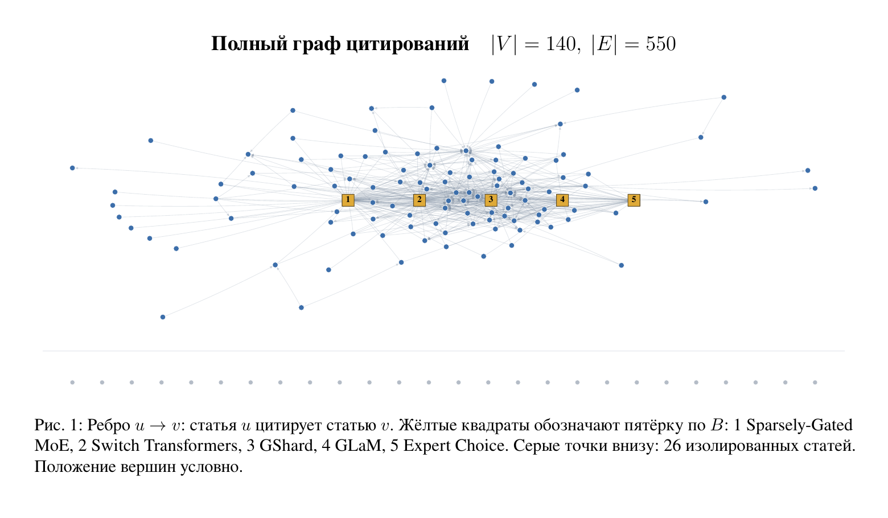

## Содержание

- [О проекте](#о-проекте)
- [Методы](#методы)
- [Что получилось](#что-получилось)
- [Как запустить](#как-запустить)
- [Структура проекта](#структура-проекта)
- [Данные и ограничения](data/README.md)

# Ключевые статьи Sparse MoE

## О проекте

В этом учебном проекте я ищу ключевые работы о разреженных смесях экспертов (Sparse MoE) в языковых моделях.

Я собрал **140 статей за 2017-2025 годы** и построил граф из **550 связей цитирования**. По нему сравниваю, какие работы чаще цитируют и как далеко расходятся цепочки ссылок на них. Данные зафиксированы на 4 ноября 2026 года.



На рисунке 34 статьи из среза 35 лидеров PageRank. Жёлтые квадраты выделяют пятёрку по `B`. Все расчёты выполнены на полном корпусе из 140 работ.

## Методы

Стрелка `u → v` означает, что статья `u` ссылается на статью `v`.

Сначала считаю, сколько работ в корпусе напрямую ссылаются на каждую статью. Это число `c`. Затем считаю PageRank: он учитывает и сами ссылки, и положение цитирующих работ в сети.

Дальше я смотрю на цепочки цитирования. Показатель `U` учитывает каждую связанную работу один раз, по кратчайшему пути. Чем длиннее путь, тем меньше её вклад.

Основным показателем я выбрал `B`. Он учитывает, насколько охват распределён по разным ветвям. Ветвью называю статью, которая напрямую ссылается на оцениваемую работу. Если весь охват проходит через одну такую статью, `B` равен нулю.

Для сравнения использую ещё три показателя:

- **Katz** учитывает все цепочки ссылок, включая несколько путей от одной статьи.
- **Дробный подсчёт `F`** делит один голос статьи между её ссылками внутри корпуса.
- **Текстовый пилот `R`** учитывает найденные в размеченных контекстах признаки использования или развития метода.

Для `U`, `B` и Katz я исключил восемь связей, противоречащих порядку дат. Осталось 542 ребра. Коэффициент затухания равен 0,5.

## Что получилось

По `B` я получил пятёрку: **Sparsely-Gated MoE, Switch Transformers, GShard, GLaM и Expert Choice**. Для сравнения в таблице есть DeepSeekMoE.

| Работа | Год | Ссылки в корпусе | Место по PageRank | Место по B |
| --- | --- | --- | --- | --- |
| Sparsely-Gated MoE | 2017 | 83 | 1 | 1 |
| Switch Transformers | 2021 | 74 | 3 | 2 |
| GShard | 2020 | 63 | 2 | 3 |
| GLaM | 2021 | 39 | 4 | 4 |
| Expert Choice | 2022 | 31 | 6 | 5 |
| DeepSeekMoE | 2024 | 31 | 5 | 6 |

Первые четыре работы по `B` входят и в пятёрку PageRank, хотя их порядок отличается. Пятый участник зависит от метода: `B` выбирает Expert Choice, PageRank выбирает DeepSeekMoE.

У Expert Choice и DeepSeekMoE по **31 прямой ссылке**. Это ничья на местах 5 и 6. В экспериментах я использую средний ранг 5,5 и делю последнее место первой пятёрки поровну.

## Как запустить

Нужен Python 3.10 или новее. Команды для Windows:

```powershell
py -m pip install -r requirements.txt
py -X utf8 run_pipeline.py
```

В Linux и macOS вместо `py` используйте `python` или `python3`.

Расчёт работает без интернета и API-ключей. Полный запуск строит рейтинги, выполняет эксперименты и сохраняет рисунки. Для основных расчётов:

```powershell
py -X utf8 run_pipeline.py --skip-stress --no-figures
```

Результаты появятся в `output/`: таблицы в `tables/`, эксперименты в `robustness/`, сводки и основные рисунки в корне папки. Она создаётся локально и не хранится в Git.

## Структура проекта

```text
.
├── README.md
├── assets/
│   └── citation_graph.png
├── data/                        # корпус, свидетельства и описание данных
├── src/
│   ├── corpus.py                # граф и базовые рейтинги
│   ├── metrics.py               # U, B, Katz и текстовый пилот
│   ├── experiments.py           # дробный подсчёт и устойчивость
│   ├── figures.py               # рисунки
│   └── storage.py               # чтение и сохранение данных
├── tools/
│   └── prepare_data.py          # восстановление входов из исходного снимка
├── run_pipeline.py              # запуск всех этапов
├── requirements.txt
├── settings.json                # выбранные работы и разметка контекстов
└── texts.json                   # описания показателей и подписи рисунков
```

Описание файлов, источников и ограничений я вынес в [README папки data](data/README.md).
