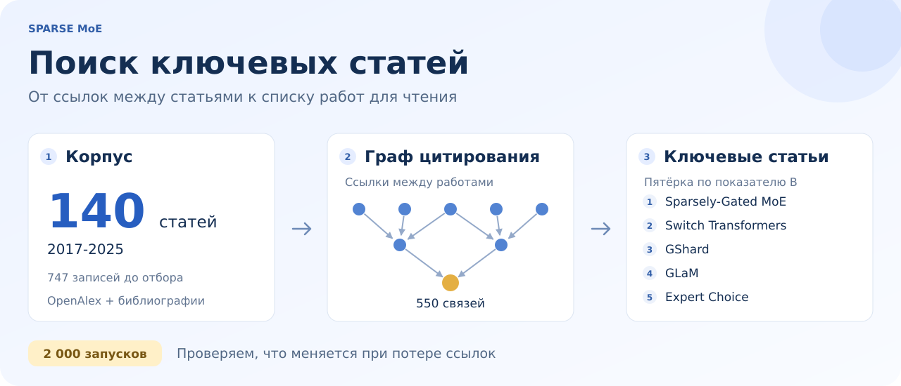

## Содержание

- [О проекте](#о-проекте)
- [Как считаем](#как-считаем)
- [Что получилось](#что-получилось)
- [Как запустить](#как-запустить)
- [Структура проекта](#структура-проекта)
- [Данные и ограничения](#данные-и-ограничения)

# Ключевые статьи Sparse MoE



## О проекте

Когда в области сотни статей, сложно понять, с каких начать. В этом учебном проекте мы ищем ключевые работы о разреженных смесях экспертов (Sparse MoE) в языковых моделях.

Мы собрали корпус из **140 статей за 2017-2025 годы** и построили граф из **550 связей цитирования**. В нём можно посмотреть, на какие работы ссылаются напрямую и какие статьи связаны через несколько шагов. Данные зафиксированы на 4 ноября 2026 года.

Главный вопрос проекта: получится ли выбрать ключевые статьи, если учитывать распространение ссылок по разным ветвям графа?

## Как считаем

Стрелка `u → v` означает, что статья `u` ссылается на статью `v`. На одном корпусе сравниваем несколько показателей.

| Показатель | Что он учитывает |
| --- | --- |
| Число ссылок `c` | Сколько статей нашего корпуса напрямую ссылаются на работу |
| PageRank | Положение работы в сети с учётом того, какие статьи на неё ссылаются |
| Охват `U` | Сколько разных статей ведут к работе по кратчайшим цепочкам ссылок с затуханием по длине пути |
| Разнообразие ветвей `B` | Охват и то, насколько равномерно он распределён между ветвями |
| Katz | Все цепочки ссылок с затуханием, включая несколько путей от одной статьи |
| Дробный подсчёт `F` | Один голос цитирующей статьи, разделённый между её ссылками внутри корпуса |
| Текстовый пилот `R` | Найденные в размеченных контекстах признаки использования или развития метода |

Основным показателем выбрали `B`. Ветвью здесь называем статью, которая напрямую ссылается на оцениваемую работу. Если вся дальнейшая цепочка проходит через одну такую статью, `B` равен нулю. Поэтому важная работа с одной линией продолжения может получить низкую оценку.

Для `U`, `B` и Katz используем граф без восьми связей, которые противоречат порядку дат. В нём остаётся 542 ребра. Базовое значение коэффициента затухания равно 0,5.

## Что получилось

По показателю `B` получилась пятёрка: **Sparsely-Gated MoE, Switch Transformers, GShard, GLaM и Expert Choice**. Ниже для сравнения добавлен DeepSeekMoE.

| Работа | Год | Ссылки в корпусе | Место по PageRank | Место по B |
| --- | --- | --- | --- | --- |
| Sparsely-Gated MoE | 2017 | 83 | 1 | 1 |
| Switch Transformers | 2021 | 74 | 3 | 2 |
| GShard | 2020 | 63 | 2 | 3 |
| GLaM | 2021 | 39 | 4 | 4 |
| Expert Choice | 2022 | 31 | 6 | 5 |
| DeepSeekMoE | 2024 | 31 | 5 | 6 |

Первые четыре работы по `B` входят и в пятёрку PageRank, хотя их порядок отличается. Пятый участник зависит от метода: `B` выбирает Expert Choice, PageRank выбирает DeepSeekMoE.

У Expert Choice и DeepSeekMoE по **31 прямой ссылке**. По числу ссылок между ними ничья на местах 5 и 6. В экспериментах обе работы получают средний ранг 5,5 и делят последнее место первой пятёрки поровну.

### Проверка устойчивости

Мы провели **2 000 запусков**: по 500 с удалением 10%, 30% и 50% отдельных связей, а также 500 с удалением 30% целых библиографий. Во всех запусках сохранялись все 140 статей.

При удалении 30% отдельных связей:

- Expert Choice оставалась в пятёрке по `B` в **93,8%** запусков.
- DeepSeekMoE оставалась в пятёрке PageRank в **95,8%** запусков.

Эти частоты показывают устойчивость к выбранному способу удаления данных. Они не дают вероятность того, что статья действительно является ключевой. Если оставить только связи OpenAlex, DeepSeekMoE заменяет Expert Choice и в пятёрке по `B`. Источник данных тоже влияет на выбор.

## Как запустить

Нужен Python 3.10 или новее. Команды для Windows:

```powershell
py -m pip install -r requirements.txt
py -X utf8 run_pipeline.py
```

В Linux и macOS вместо `py` используйте `python` или `python3`.

Расчёт работает на сохранённых данных без интернета и API-ключей. Полный запуск строит рейтинги, выполняет эксперименты и сохраняет рисунки. Если нужны только основные расчёты:

```powershell
py -X utf8 run_pipeline.py --skip-stress --no-figures
```

Результаты появятся в `output/`:

- `tables/` содержит рейтинги, рёбра графа и таблицы разметки.
- `robustness/` содержит результаты экспериментов, частоты попадания в пятёрку и сохранённые массивы запусков.
- В корне `output/` лежат сводки JSON и основные рисунки.

Папка `output/` создаётся локально и не хранится в Git.

## Структура проекта

```text
.
├── README.md
├── assets/
│   └── overview.svg
├── data/
│   ├── corpus.json              # корпус из 140 работ
│   ├── scope_audit.csv          # решения о включении статей
│   ├── bibliographies.json      # извлечённые библиографии
│   ├── contexts.csv             # найденные контексты цитирования
│   ├── context_coverage.csv     # покрытие связей контекстами
│   └── provenance.json          # происхождение данных и контрольные суммы
├── src/
│   ├── corpus.py                # граф и базовые рейтинги
│   ├── metrics.py               # U, B, Katz и текстовый пилот
│   ├── experiments.py           # дробный подсчёт и устойчивость
│   ├── figures.py               # рисунки
│   └── storage.py               # чтение и сохранение данных
├── tools/
│   └── prepare_data.py          # восстановление входов из исходного снимка
├── run_pipeline.py              # запуск всех этапов
├── requirements.txt
├── settings.json                # выбранные работы и разметка контекстов
└── texts.json                   # описания показателей и подписи рисунков
```

Для знакомства с кодом удобно начать с `run_pipeline.py`, затем открыть `src/corpus.py` и `src/metrics.py`.

## Данные и ограничения

Сначала получили 747 уникальных записей OpenAlex. После тематического отбора и объединения версий в корпусе осталось 140 работ. Граф включает 122 связи из метаданных OpenAlex и ещё 428 связей, найденных по названиям статей в библиографиях PDF.

Полные исходные ответы сохранены в истории Git. Скрипт `tools/prepare_data.py` восстанавливает из них компактные входы. Для него нужен полный клон репозитория. Скрипт заново записывает `data/` и `settings.json`, поэтому перед запуском стоит сохранить свою разметку. Обычный расчёт можно запустить и из скачанного ZIP-архива.

Корпус не охватывает всю область. Часть ссылок отсутствует в метаданных, а поиск названий в PDF тоже может пропустить связь. Пустой список литературы в OpenAlex не означает, что у статьи нет ссылок.

Цитирование само по себе не доказывает использование метода. Чтобы приблизиться к этому вопросу, мы извлекли 1 909 контекстов. Ассистент разметил 80 контекстов, отмеченных эвристикой, из них получились 36 положительных пар статей. Показатель `R` остаётся пилотом с неполным покрытием и без независимой человеческой разметки.

Рейтинги помогают выбрать работы для чтения. Окончательное обоснование их важности требует разбора самих статей.
